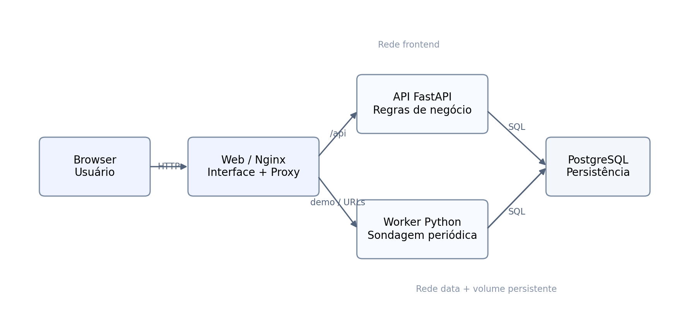

# Resumo

Este artigo apresenta o desenvolvimento do **Uptime Monitor**, uma aplicação web voltada ao monitoramento de disponibilidade de serviços HTTP e HTTPS. O projeto foi elaborado para atender aos requisitos da disciplina de Computação em Nuvem, priorizando uma arquitetura simples, funcional e facilmente demonstrável em ambiente local por meio de contêineres Docker. A solução é composta por quatro serviços: interface web com Nginx, API REST em FastAPI, worker de sondagem periódica e banco de dados PostgreSQL. Como resultado, obteve-se uma aplicação capaz de cadastrar monitores, verificar periodicamente a disponibilidade dos endereços, armazenar histórico de verificações e apresentar indicadores de latência e disponibilidade em painel web. O trabalho também evidencia conceitos centrais da disciplina, como construção de imagens, orquestração com Docker Compose, redes internas, persistência em volume e isolamento entre serviços.

**Palavras-chave:** computação em nuvem; Docker; Docker Compose; monitoramento; serviços web.

# 1. Introdução

Sistemas distribuídos e aplicações em nuvem dependem da disponibilidade contínua de serviços web. Em cenários reais, falhas de conectividade, indisponibilidade do servidor ou aumento excessivo de latência podem degradar a experiência do usuário e comprometer a confiabilidade da aplicação. Nesse contexto, ferramentas de observabilidade e monitoramento tornam-se essenciais.

O objetivo deste projeto é desenvolver uma aplicação web simples, porém completa o suficiente para demonstrar os principais conteúdos estudados na disciplina. Em vez de construir uma solução muito extensa, a proposta foi adotar um domínio coerente com infraestrutura e operação de sistemas: o monitoramento de disponibilidade de serviços HTTP.

O projeto foi guiado por quatro metas principais:

1. atender integralmente aos requisitos do trabalho final;
2. demonstrar uma arquitetura baseada em múltiplos serviços;
3. manter a implementação compreensível para apresentação e arguição;
4. funcionar localmente, sem depender de serviços pagos ou de uma infraestrutura externa.

# 2. Visão geral da aplicação

O **Uptime Monitor** permite que o usuário cadastre endereços HTTP ou HTTPS e acompanhe o seu estado por meio de um painel web. Cada monitor cadastrado possui um nome e uma URL. Periodicamente, um serviço de sondagem realiza uma requisição HTTP para cada endereço e registra o resultado no banco de dados.

Com base nesses registros, a interface apresenta:

- quantidade total de monitores cadastrados;
- número de serviços disponíveis e indisponíveis;
- latência média recente;
- disponibilidade acumulada por serviço;
- histórico de verificações e gráfico de latência.

Além disso, a aplicação possui uma funcionalidade de **demonstração local**, que cadastra dois alvos internos: um endpoint que responde com sucesso e outro que responde com erro. Dessa forma, é possível demonstrar a aplicação mesmo que a internet não esteja disponível no momento da apresentação.

# 3. Arquitetura da solução

A arquitetura foi organizada em quatro serviços independentes, executados por meio de Docker Compose. Essa divisão favorece o isolamento de responsabilidades e demonstra com clareza o modelo de composição de serviços.



## 3.1 Serviços da aplicação

A Tabela 1 resume os componentes implementados.

| Serviço | Tecnologia | Responsabilidade principal |
|---|---|---|
| Web | Nginx + HTML/CSS/JS | Servir a interface web, arquivos estáticos e atuar como proxy reverso da API |
| API | FastAPI | Receber requisições do frontend, validar dados, consultar e alterar o banco |
| Worker | Python | Realizar sondagens periódicas dos sites e gravar os resultados |
| Banco de dados | PostgreSQL | Persistir monitores e histórico de verificações |

A aplicação utiliza duas redes Docker lógicas:

- **frontend**: conecta o serviço web aos demais componentes necessários para a exposição da aplicação ao usuário;
- **data**: rede interna entre API, worker e banco, isolando o PostgreSQL do acesso externo.

Somente o Nginx publica porta para o host, e essa exposição é feita apenas em `localhost`, o que reforça o isolamento e evita o acesso direto ao banco.

## 3.2 Justificativa arquitetural

A escolha por quatro serviços atende com folga o requisito mínimo de três serviços e demonstra um cenário clássico de arquitetura em camadas. Além disso, há pelo menos dois serviços de implementação própria: a API e o worker. Isso evita que o projeto seja apenas uma composição de imagens prontas do Docker Hub, o que foi explicitamente exigido no enunciado.

# 4. Estrutura e implementação

## 4.1 Organização do código

O projeto foi organizado de forma modular, separando backend, frontend, testes e documentação. A estrutura principal está resumida abaixo.

```text
uptime-monitor/
├─ compose.yaml
├─ backend/
│  ├─ Dockerfile
│  ├─ api.py
│  ├─ db.py
│  ├─ probe.py
│  ├─ schema.sql
│  └─ worker.py
├─ web/
│  ├─ index.html
│  ├─ styles.css
│  ├─ app.js
│  └─ nginx.conf
├─ tests/
│  └─ test_app.py
└─ docs/
   ├─ APRESENTACAO.md
   └─ artigo-uptime-monitor.md
```

Essa organização facilita tanto o desenvolvimento quanto a compreensão do projeto durante a avaliação.

## 4.2 Banco de dados

O banco PostgreSQL armazena duas entidades principais:

- **sites**: tabela com identificador, nome e URL do serviço monitorado;
- **checks**: tabela de histórico, contendo o resultado de cada sondagem, incluindo horário, código HTTP, latência e mensagem de erro quando existir.

A relação entre as tabelas é de um para muitos: um site possui várias verificações ao longo do tempo. Esse modelo é suficiente para calcular disponibilidade acumulada e construir o histórico mostrado na interface.

## 4.3 API REST

A API foi implementada com FastAPI por oferecer simplicidade, boa organização e facilidade de definição de contratos HTTP. Os principais endpoints são apresentados na Tabela 2.

| Método | Endpoint | Finalidade |
|---|---|---|
| GET | `/api/health` | verifica a saúde da API e a conexão com o banco |
| GET | `/api/sites` | lista os monitores cadastrados e o último resultado conhecido |
| POST | `/api/sites` | cadastra um novo monitor |
| GET | `/api/sites/{id}/history` | retorna o histórico recente do monitor selecionado |
| DELETE | `/api/sites/{id}` | remove o monitor e seu histórico |
| POST | `/api/demo` | cria os monitores de demonstração local |

Antes de persistir um novo monitor, a API valida o formato do nome e da URL, aceitando apenas endereços HTTP e HTTPS. Essa validação evita entradas inválidas e reforça a confiabilidade da aplicação.

## 4.4 Worker de sondagem

O worker executa continuamente um ciclo de verificação dos sites cadastrados. Em cada ciclo, ele consulta a lista de monitores no banco, realiza as requisições HTTP e grava os resultados obtidos.

A lógica de monitoramento segue os critérios abaixo:

- respostas **2xx** e **3xx** são consideradas **online**;
- respostas **4xx** e **5xx** são consideradas **offline**;
- falhas de DNS, TLS, conexão ou timeout também são registradas como **offline**;
- a latência é medida do início da requisição até a obtenção da resposta ou até a falha.

Após concluir um ciclo, o worker aguarda um intervalo configurado e reinicia o processo. Esse comportamento permite que o painel seja atualizado continuamente.

## 4.5 Interface web

A interface foi construída com HTML, CSS e JavaScript puros, sem dependência de frameworks externos. Essa escolha torna a solução mais leve e facilita a inspeção do código durante a apresentação.

As principais funcionalidades da interface são:

- visualização das métricas gerais do sistema;
- listagem de monitores e seus estados;
- cadastro e remoção de monitores;
- detalhamento do monitor selecionado;
- exibição gráfica da latência recente;
- consumo automático da API para atualização periódica do painel.

Do ponto de vista visual, a UI foi projetada para manter aparência limpa, leitura clara e navegação direta, sem exageros visuais que prejudiquem a objetividade acadêmica do sistema.

# 5. Contêineres e orquestração

A orquestração é feita com `docker compose`, responsável por subir os quatro serviços, criar as redes e provisionar o volume persistente do banco.

## 5.1 Imagem própria

Os serviços `api` e `worker` utilizam um `Dockerfile` próprio baseado em Python, atendendo ao requisito de possuir pelo menos um serviço de implementação própria. Na prática, uma única imagem é construída e reutilizada pelos dois serviços, alterando apenas o comando de inicialização.

## 5.2 Persistência

O PostgreSQL utiliza um volume nomeado para armazenar os dados. Isso permite que os registros sejam mantidos mesmo após a remoção dos contêineres com `docker compose down`, desde que o volume não seja removido com a opção `-v`.

## 5.3 Healthchecks e dependências

Foram definidos healthchecks e dependências entre os serviços para reduzir falhas de inicialização. Dessa forma, a aplicação aguarda a disponibilidade do banco e da API antes de liberar os componentes dependentes.

# 6. Execução e uso da aplicação

Após extrair o projeto, basta abrir a pasta raiz e executar:

```bash
docker compose up -d --build
```

Em seguida, o painel pode ser acessado em `http://localhost:8080`.

Para uma demonstração rápida, o usuário pode clicar em **Carregar demonstração**, o que cadastra dois serviços internos:

- `/demo/online`: retorna sucesso;
- `/demo/offline`: retorna erro 503.

Com isso, a aplicação já apresenta um cenário completo de monitoramento, exibindo um serviço disponível e outro indisponível.

O fluxo típico de uso é o seguinte:

1. subir a aplicação com Docker Compose;
2. acessar a interface pelo navegador;
3. carregar a demonstração ou cadastrar novos sites;
4. aguardar as verificações do worker;
5. consultar métricas, histórico e gráfico de latência.

# 7. Resultados obtidos

O sistema foi validado por meio de testes automatizados e de inspeção funcional da interface.

## 7.1 Testes automatizados

Foram executados testes direcionados cobrindo, entre outros pontos:

- validação das rotas da API;
- cadastro e listagem de monitores;
- exclusão de registros;
- histórico de verificações;
- validação de URL;
- comportamento da rotina de sondagem HTTP.

Ao final, **13 de 13 testes** foram aprovados no ambiente de desenvolvimento utilizado para a construção do projeto.

## 7.2 Resultado funcional

Em execução, a aplicação foi capaz de:

- cadastrar novos monitores;
- exibir estados online e offline;
- calcular disponibilidade acumulada;
- registrar latência e código HTTP;
- persistir os dados em banco;
- manter os registros após reinicialização dos contêineres.

Esses resultados mostram que a solução atende ao objetivo principal proposto para o trabalho.

# 8. Limitações e melhorias futuras

Por se tratar de um projeto acadêmico com foco em simplicidade e demonstração local, algumas funcionalidades comuns em soluções profissionais não foram implementadas. Entre as limitações, destacam-se:

- ausência de autenticação e controle de acesso;
- inexistência de envio de alertas por e-mail ou mensageria;
- cálculo de disponibilidade apenas com base em contagem de verificações, e não em janelas temporais avançadas;
- falta de filtros e relatórios mais completos;
- execução voltada ao ambiente local, e não a uma implantação pública em nuvem.

Como trabalhos futuros, seria possível adicionar autenticação, alertas em tempo real, dashboards mais avançados, configuração de intervalos por serviço e implantação em um provedor de nuvem.

# 9. Conclusão

O projeto **Uptime Monitor** atendeu aos requisitos propostos para o trabalho final da disciplina de Computação em Nuvem. A solução implementa uma aplicação web funcional, acessível por navegador e composta por múltiplos serviços containerizados. Além disso, apresenta pelo menos um serviço de implementação própria, organização estrutural adequada e elementos claros para demonstração prática em apresentação.

Do ponto de vista didático, o trabalho permitiu aplicar conceitos importantes de conteinerização, comunicação entre serviços, persistência, orquestração e isolamento. A escolha por um sistema de monitoramento de disponibilidade mostrou-se adequada por combinar simplicidade de implementação com boa coerência técnica em relação ao conteúdo da disciplina.

# Referências

DOCKER INC. *Docker documentation*. Disponível em: <https://docs.docker.com/>. Acesso em: 25 nov. 2026.

FASTAPI. *FastAPI documentation*. Disponível em: <https://fastapi.tiangolo.com/>. Acesso em: 25 nov. 2026.

POSTGRESQL GLOBAL DEVELOPMENT GROUP. *PostgreSQL documentation*. Disponível em: <https://www.postgresql.org/docs/>. Acesso em: 25 nov. 2026.

NGINX. *NGINX documentation*. Disponível em: <https://nginx.org/en/docs/>. Acesso em: 25 nov. 2026.
